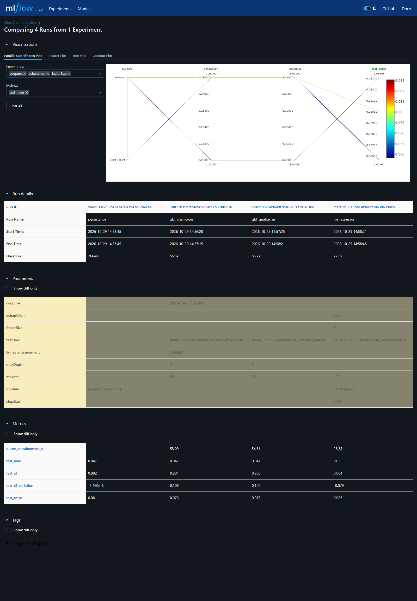
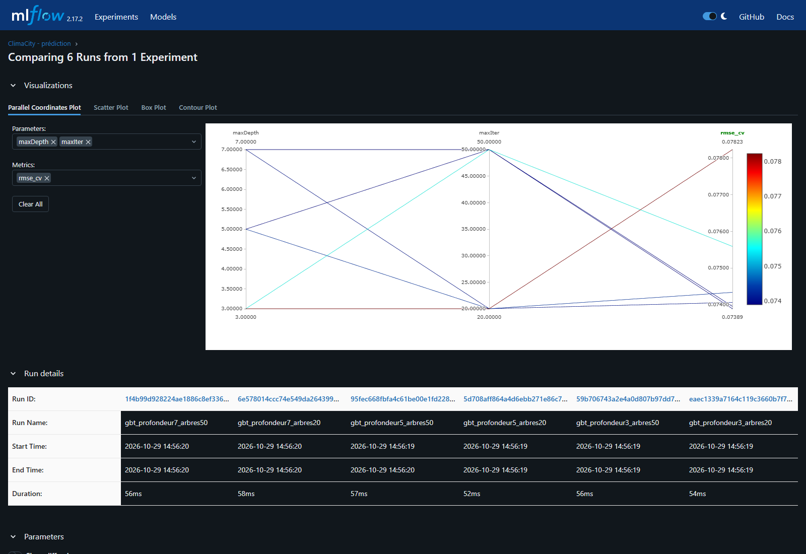
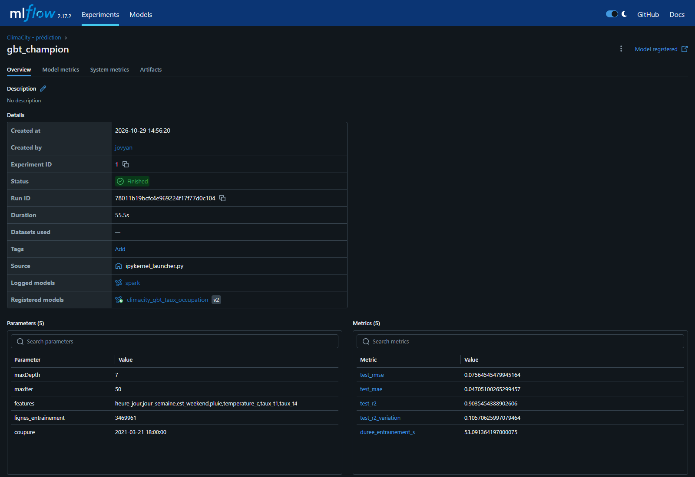
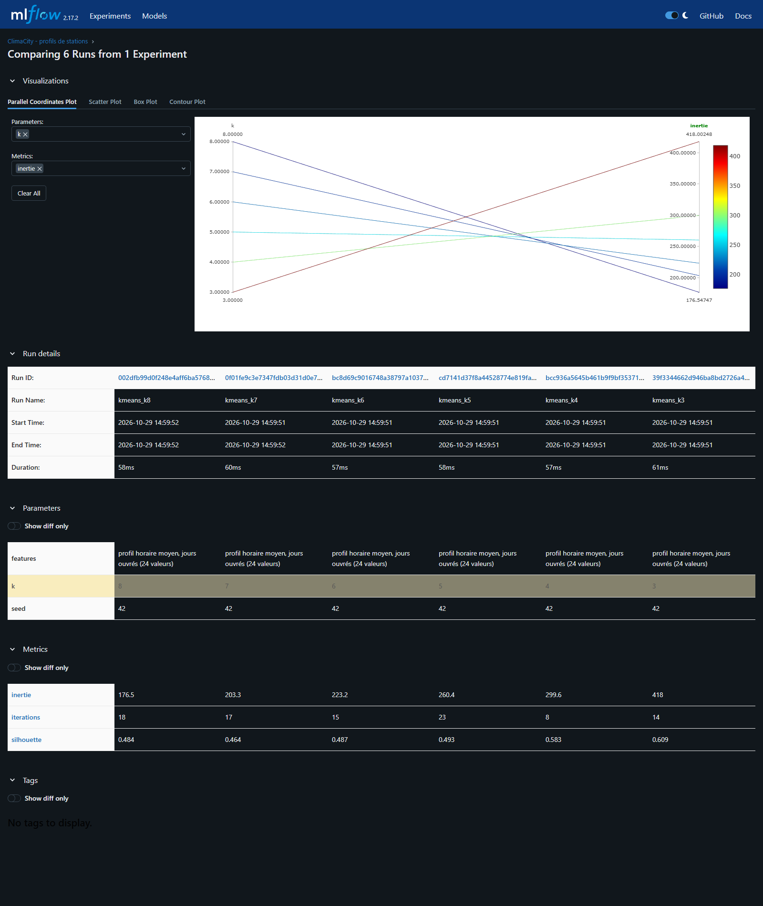
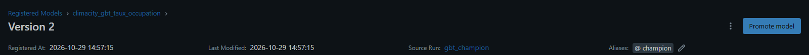

# ClimaCity Paris

Projet Spark / PySpark du module « Traitement de données massives » : prévoir la tension des
stations Vélib' à partir de leur historique, de la météo et de la qualité de l'air.
Énoncé : [CoursSpark / Projets / Cyclo](https://github.com/Septentrion/CoursSpark/tree/main/Projets/Cyclo).

## Lancer l'environnement

Prérequis : Docker Desktop (WSL 2 sous Windows), 8 Go de mémoire alloués à Docker.

```bash
cp .env.example .env      # adapter la mémoire à la machine
docker compose up -d --build
```

| Service | Adresse |
|---------|---------|
| JupyterLab | http://localhost:8888/lab?token=climacity |
| Spark UI | http://localhost:4040 (après création d'une SparkSession) |
| MLflow | http://localhost:5000 |

## Exécuter les carnets

Tous les carnets importent `scripts/config.py` (chemins relatifs à la racine, graine, paramètres Spark,
`creer_session()`). Chacun tourne dans un noyau neuf et ne dépend que des fichiers de `data/` : on peut
les rejouer sans clic, de la première à la dernière cellule.

```bash
docker exec -w /home/jovyan climacity-aker-jupyter python scripts/executer.py notebooks/00_configuration.ipynb
```

Les carnets s'exécutent dans l'ordre : chacun lit les fichiers écrits par les précédents dans
`data/output` (Parquet, tables Delta, `mesures.json`).

| Carnet | Jour | Lit | Écrit |
|--------|------|-----|-------|
| `00_configuration` | | | données brutes (via `collecte.py`) |
| `01_rdd_exploration` | 1 matin | CSV gzip | `rdd_releves_par_station` |
| `02_dataframe_pipeline` | 1 après-midi | CSV gzip, GBFS, météo, air | `disponibilite_parquet`, `stations`, `meteo_horaire`, `air_horaire` |
| `03_spark_sql_delta` | 2 matin | Parquet du carnet 02 | tables Delta `disponibilite`, `features_temporelles`, résultats Q1 à Q3 |
| `04_streaming` | 2 après-midi | Delta `disponibilite` | Delta `flux_arrondissements`, `flux_stations`, `alertes` |
| `05_mllib_prediction` | 3 matin | Delta `disponibilite`, météo, air | modèle `gbt_champion`, runs MLflow, `carte_clusters.html` |
| `06_optimisation_bilan` | 3 après-midi | Parquet, Delta, `mesures.json` | `mesures.json` complété |

Le carnet 05 inscrit à chaque exécution une nouvelle version du modèle au registre MLflow et y déplace
l'alias `champion`.

## Données

Rien n'est versionné : `scripts/collecte.py` télécharge tout (~500 Mo, 4 min environ) et ne fait que de
l'acquisition. Le parsing et l'enrichissement se font ensuite en Spark dans les carnets.

```bash
docker exec -w /home/jovyan climacity-aker-jupyter python scripts/collecte.py --data data
```

| Source | Contenu | Dépôt dans `data/` |
|--------|---------|--------------------|
| [historique-velib-opendata](https://github.com/lovasoa/historique-velib-opendata) | 10 986 730 relevés, 1 399 stations, du 26/11/2020 au 09/04/2021, un relevé par station toutes les ~15 min | `velib/raw/velib_<quinzaine>.csv.gz` (10 fichiers) |
| API GBFS Vélib' Métropole | référentiel actuel des stations (code -> arrondissement) | `velib/station_information.json` |
| Open-Meteo (archive) | météo horaire de Paris-Montsouris, UTC | `meteo/meteo_montsouris_horaire.csv` |
| EEA, service de téléchargement | NO2 (33 points de mesure) et PM2.5 (8) horaires validés d'Airparif | `air/raw/*.parquet` (50 fichiers) |

**Écart avec l'énoncé.** L'extrait Vélib' 2022-2023 annoncé n'est pas public : le seul historique ouvert
couvre l'hiver 2020-2021 (couvre-feu puis confinement). L'apprentissage utilisera donc un découpage
temporel plutôt que 2022 / 2023. OpenAQ exigeant désormais une clé, la qualité de l'air vient de l'EEA.

## Avancement

| Étape | Contenu | État |
|-------|---------|------|
| 1 | Socle : structure, environnement Docker (Spark 3.5, Delta 3.2, MLflow 2.17) | fait |
| 2 | Collecte des données (Vélib', GBFS, Open-Meteo, qualité de l'air EEA) | fait |
| 3 | `00_configuration` : paramètres et vérification de l'environnement | fait |
| 4 | `01_rdd_exploration` (Jour 1 matin) : parsing RDD, comptage par station, trous de collecte, Pandas / Spark, DAG | fait |
| 5 | `02_dataframe_pipeline` (Jour 1 après-midi) : nettoyage, référentiel des stations, météo, air, jointures broadcast, cache, Parquet | fait |
| 6 | `03_spark_sql_delta` (Jour 2 matin) : 3 questions métier en SQL, LAG / LEAD et moyenne mobile 3 h, Delta (MERGE, time travel) | fait |
| 7 | `04_streaming` (Jour 2 après-midi) : simulateur de flux, `readStream` à schéma explicite, fenêtres glissantes 10 min / 2 min avec watermark, sink Delta, table `alertes`, rejet prouvé de la donnée tardive, reprise sur checkpoint | fait |
| 8 | `05_mllib_prediction` (Jour 3 matin) : features à décalages vérifiés en temps, Pipeline GBT et `CrossValidator` à plis temporels, MLflow (registre, alias `champion`), sauvegarde et rechargement, bonus qualité de l'air et `FMRegressor`, K-Means (k = 4) et carte Folium, cache sur calcul itératif | fait |
| 9 | `06_optimisation_bilan` (Jour 3 après-midi) : stage lent du Jour 2 (API REST du Spark UI), déséquilibre corrigé par repartitionnement, broadcast / SortMergeJoin, partitions du clustering, Pandas / Spark, bilan d'architecture | fait |

## Résultats

**Questions métier (carnet 03).**

- Les stations le plus souvent vides entre 8 h et 10 h sont toutes en hauteur : Piat - Parc de Belleville
  est vide sur 37,9 % des relevés, et le 20e arrondissement sur 10,4 %.
- La pluie réduit les déplacements d'environ 23 % (± 4), à heure et type de jour égaux. Le taux
  d'occupation monte alors de 1,3 point, puisque plus de vélos restent à quai.
- La plus forte saisonnalité dans la journée est celle de Gare du Nord - Denain (amplitude 0,83).

**Flux (carnet 04).** Le flux calcule les fenêtres glissantes par arrondissement et produit 365 alertes de
stations vides, identiques à un recalcul batch. Une donnée en retard d'un quart d'heure est acceptée, une
donnée en retard d'une heure est rejetée par le watermark. Le carnet le prouve par une assertion sur
`numRowsDroppedByWatermark` et par une contre-épreuve batch.

**Prédiction à une heure (carnet 05).**

| Modèle | RMSE (test) | R² | Variation horaire expliquée |
|--------|-------------|----|-----------------------------|
| Persistance (taux de l'heure précédente) | 0,0800 | 0,892 | 0 % |
| GBT champion (profondeur 7, 50 arbres) | 0,0756 | 0,904 | 10,6 % |
| GBT + NO2 / PM2.5 | 0,0757 | 0,903 | 10,4 % |
| FMRegressor | 0,0831 | 0,884 | -7,9 % |

Le GBT réduit l'erreur jusqu'à 16 % aux heures de pointe. La qualité de l'air n'apporte rien.

**Clustering (carnet 05).** Le K-Means à k = 4 sépare quatre profils de stations : résidentiel (surtout dans
l'est et le nord), lieux de travail (au centre), souvent vides, souvent pleines.

**Performances (contrainte n°6 et carnet 06).**

- Le cache rend la jointure du carnet 02 13 fois plus rapide, et la boucle K-Means 16 fois plus rapide.
- La jointure météo en broadcast est 2 fois plus rapide qu'en SortMergeJoin, sans aucun shuffle.
- Avec 200 partitions au lieu d'une, K-Means est 5 fois plus lent.

Le bilan d'architecture complet est à la fin du carnet 06.

### Suivi MLflow

| Comparaison des modèles | Validation croisée (6 combinaisons) |
|---|---|
|  |  |
| **Run du champion** | **K-Means, k de 3 à 8** |
|  |  |



## Arborescence

```
notebooks/   carnets 00 à 06
scripts/     config.py (configuration partagée), collecte.py, executer.py, simulateur de flux
conf/        configuration Spark
docs/        captures de l'interface MLflow
data/        données et sorties, hors dépôt
```
